# Lược đồ cơ sở dữ liệu (Database Schema)

Tài liệu đặc tả toàn bộ cấu trúc các bảng và mối quan hệ thực tế trong cơ sở dữ
liệu PostgreSQL của hệ thống eManagement, được đồng bộ chuẩn hóa theo các bản
cập nhật Flyway Migration.

```mermaid
erDiagram
    ROLES ||--o{ USER_ROLES : "gán cho"
    USERS ||--o{ USER_ROLES : "sở hữu"
    USERS ||--o{ FACE_DATA : "đăng ký 5 ảnh eKYC"
    USERS ||--o{ EMPLOYEE_SHIFTS : "phân công"
    SHIFTS ||--o{ EMPLOYEE_SHIFTS : "áp dụng"
    USERS ||--o{ ATTENDANCE_RECORDS : "chấm công AI"
    KIOSKS ||--o{ ATTENDANCE_RECORDS : "ghi nhận tại trạm"
    SHIFTS ||--o{ ATTENDANCE_RECORDS : "thuộc ca"
    USERS ||--o{ LEAVE_REQUESTS : "tạo đơn"
    USERS ||--o{ LEAVE_REQUESTS : "phê duyệt"
    USERS ||--o{ ANOMALY_ALERTS : "nhận cảnh báo"
    USERS ||--o{ ANOMALY_ALERTS : "xử lý giải trình"
    USERS ||--o{ REFRESH_TOKENS : "sở hữu token"
    USERS ||--o{ NOTIFICATIONS : "nhận thông báo"
    USERS ||--o{ BULK_IMPORT_JOBS : "thực thi import"

    ROLES {
        bigint id PK
        varchar name UK
        text description
    }

    USERS {
        bigint id PK
        varchar employee_code UK
        varchar full_name
        varchar email UK
        varchar phone UK
        varchar password_hash
        varchar avatar_url
        varchar status
        integer failed_login_attempts
        timestamp account_locked_until
        boolean is_email_verified
        boolean is_phone_verified
        timestamp created_at
        timestamp updated_at
    }

    USER_ROLES {
        bigint user_id PK, FK
        bigint role_id PK, FK
    }

    OTP_CODES {
        bigint id PK
        varchar identifier
        varchar otp_code
        varchar type
        timestamp expires_at
        boolean is_used
        timestamp created_at
    }

    REFRESH_TOKENS {
        bigint id PK
        bigint user_id FK
        varchar token_hash UK
        timestamp expiry_date
        boolean revoked
        timestamp revoked_at
        timestamp created_at
    }

    FACE_DATA {
        bigint id PK
        bigint user_id FK
        text face_vector
        varchar front_image_url
        varchar blink_image_url
        varchar left_image_url
        varchar right_image_url
        varchar up_image_url
        timestamp created_at
    }

    SHIFTS {
        bigint id PK
        varchar shift_code UK
        varchar name
        time start_time
        time end_time
        integer grace_period_minutes
        boolean is_active
        timestamp created_at
        timestamp updated_at
    }

    EMPLOYEE_SHIFTS {
        bigint id PK
        bigint user_id FK
        bigint shift_id FK
        date assigned_date UK
        varchar shift_name
        time start_time
        time end_time
        integer grace_period_minutes
        timestamp created_at
    }

    KIOSKS {
        bigint id PK
        varchar kiosk_code UK
        varchar name
        text device_token UK
        varchar status
        timestamp created_at
    }

    ATTENDANCE_RECORDS {
        bigint id PK
        bigint user_id FK
        bigint kiosk_id FK
        bigint shift_id FK
        timestamp check_in_time
        timestamp check_out_time
        varchar status
        text snapshot_url
        text checkout_snapshot_url
        timestamp created_at
    }

    LEAVE_REQUESTS {
        bigint id PK
        bigint user_id FK
        date start_date
        date end_date
        text reason
        varchar status
        bigint approved_by FK
        timestamp created_at
        timestamp updated_at
    }

    ANOMALY_ALERTS {
        bigint id PK
        bigint user_id FK
        varchar alert_type
        date alert_date
        text description
        boolean is_resolved
        bigint resolve_by FK
        timestamp created_at
    }

    NOTIFICATIONS {
        bigint id PK
        bigint user_id FK
        varchar type
        varchar title
        text message
        bigint reference_id
        boolean is_read
        timestamp created_at
    }

    BULK_IMPORT_JOBS {
        bigint id PK
        varchar file_name
        bigint file_size
        varchar status
        integer total_records
        integer processed_records
        integer success_count
        integer failed_count
        text error_log
        bigint created_by_user_id FK
        timestamptz started_at
        timestamptz finished_at
        timestamptz created_at
        timestamptz updated_at
    }
```

